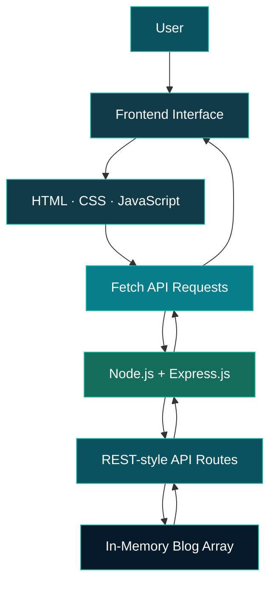

 <div align="center">

# 📝 Blog Management System

### `WRITE. MANAGE. SHARE.`

A full-stack blog application built with a responsive frontend and a Node.js + Express.js backend.


[](https://developer.mozilla.org/en-US/docs/Web/HTML)
[](https://developer.mozilla.org/en-US/docs/Web/CSS)
[](https://developer.mozilla.org/en-US/docs/Web/JavaScript)
[](https://nodejs.org/)
[](https://expressjs.com/)

**A project developed during my Full Stack Development Internship at Codomax Digital Solutions.**

</div>

---

## 🌊 About the Project

The **Blog Management System** is a full-stack web application designed to make creating and managing blog posts simple and intuitive.

Built using HTML, CSS, and vanilla JavaScript on the frontend, with Node.js and Express.js powering the backend, the application demonstrates how a web interface communicates with REST-style API endpoints to perform blog management operations.

The project focuses on CRUD functionality, form validation, responsive design, and client-server communication.

## ✨ Features

| Feature | Description |
|---|---|
| 🏠 **Blog Home** | View the blog interface and available posts |
| ✍️ **Create Blogs** | Add posts with a title, author, and content |
| 📖 **View Posts** | Retrieve and display blog information |
| 🛠️ **Edit Blogs** | Update existing post details |
| 🗑️ **Delete Blogs** | Remove posts with a confirmation dialog |
| ✅ **Form Validation** | Validate required blog fields before submission |
| 🔗 **API Integration** | Communicate with the Express backend using Fetch API |
| 📱 **Responsive UI** | Adapt the interface for different screen sizes |
| 🎨 **Interactive Design** | Use animations and hover effects for a polished experience |

## 🧰 Tech Stack

<div align="center">

| Layer | Technologies |
|---|---|
| Frontend | HTML5, CSS3, JavaScript |
| Backend | Node.js, Express.js |
| Communication | Fetch API, JSON |
| Development Tools | npm, Git, GitHub |

</div>

## 🏗️ Application Architecture



## 🔌 API Endpoints

The Express.js server exposes endpoints for managing blog posts.

| Method | Endpoint | Purpose |
|---|---|---|
| `GET` | `/blogs` | Retrieve all blog posts |
| `GET` | `/blogs/:id` | Retrieve a specific post |
| `POST` | `/blogs` | Create a new post |
| `PUT` | `/blogs/:id` | Update an existing post |
| `DELETE` | `/blogs/:id` | Delete a post |

## ⚙️ Getting Started

Follow these steps to run the project locally.

### Prerequisites

- [Node.js](https://nodejs.org/) installed on your system
- npm, included with Node.js
- Git

### Installation

**1. Clone the repository**

```bash
git clone https://github.com/Saheera-006/blog-management-system.git
```

**2. Navigate to the project folder**

```bash
cd blog-management-system
```

**3. Install dependencies**

```bash
npm install
```

**4. Start the server**

```bash
node server.js
```

**5. Open the application**

Visit the following address in your browser:

```text
http://localhost:3000
```

The application runs locally while the Node.js server is active.

## 📁 Project Structure

```text
blog-management-system/
├── public/
│   ├── index.html
│   ├── blog.html
│   ├── style.css
│   └── script.js
├── server.js
├── package.json
├── package-lock.json
└── README.md
```

*Note: The server serves the frontend from the `public/` directory. The repository may also contain additional root-level copies of frontend files.*

## 🧠 Key Learning Outcomes

- Implementing CRUD operations using Node.js and Express.js
- Connecting frontend interactions to backend API endpoints
- Sending and receiving JSON data with Fetch API
- Handling form validation and unsuccessful API responses
- Organizing a basic full-stack application
- Using Git and GitHub for source control

## 🔭 Future Improvements

- Integrate a database for persistent blog storage
- Add user authentication and authorization
- Support blog categories, search, and filtering
- Add rich-text editing and image uploads
- Deploy the application for public access

## 👩‍💻 Developer

**Fathima Saheera J**

*Aspiring Full Stack Developer | B.E. Computer Science and Engineering*

[](https://github.com/Saheera-006)
[](https://fathima-saheera.web.app)

---

<div align="center">

**Designed to write. Built to manage. Ready to grow.**


</div>