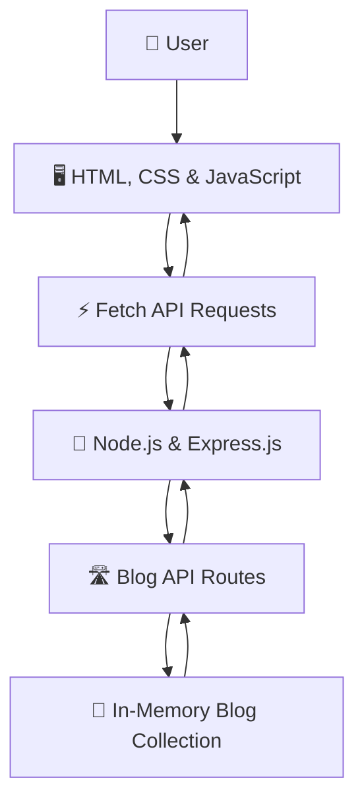

# ✍️ Blog Management System

<div align="center">


<br/>

<a href="https://github.com/Saheera-006/blog-management-system">
  
</a>

<br/><br/>


<br/><br/>


</div>

---

## ✦ About the Project

**Blog Management System** is a full-stack web application developed during the Full Stack Development Internship at **Codomax Digital Solutions**.

The application provides a simple interface for creating and managing blog posts. Users can add posts with a title, author name, and content, view existing posts, edit their details, and delete posts when they are no longer needed.

The frontend uses HTML, CSS, and JavaScript, while a Node.js and Express.js server provides REST-style endpoints for blog operations.

> *A simple space to create, organize, and manage ideas through writing.*

## ✨ Features

| Feature | Description |
|---|---|
| 🏠 **Home Page** | View the main blog interface and available posts. |
| ✍️ **Create Blog** | Add a blog title, author name, and content. |
| 📚 **View Blogs** | Retrieve and display blog posts. |
| 📝 **Edit Blog** | Update the details of an existing post. |
| 🗑️ **Delete Blog** | Delete a post with a confirmation dialog. |
| ✅ **Form Validation** | Check required fields before saving a post. |
| 🔄 **REST API Integration** | Communicate between the frontend and Express server using HTTP requests. |
| ⚡ **Dynamic Rendering** | Update blog content in the interface using JavaScript. |
| 🎨 **Interactive UI** | Includes animations and hover effects. |

## 🧰 Tech Stack

<div align="center">

| Technology | Purpose |
|:---:|---|
| **HTML5** | Structures the pages and forms |
| **CSS3** | Handles styling, layout, and hover effects |
| **JavaScript** | Implements validation, events, and dynamic content |
| **Node.js** | Runs the server-side JavaScript application |
| **Express.js** | Serves the application and handles HTTP routes |
| **Fetch API** | Sends asynchronous requests from the frontend |
| **Git & GitHub** | Version control and source code hosting |

</div>

## 🏗️ Application Architecture

The application follows a straightforward client-server architecture.



### How It Works

1. The user interacts with the blog interface.
2. JavaScript validates the form and prepares the request.
3. The Fetch API sends a request to the Express server.
4. Express handles operations such as retrieving, creating, updating, or deleting posts.
5. The server returns the relevant response.
6. The frontend updates the displayed blog content.

**Data storage note:** The current server implementation stores blog posts in an in-memory JavaScript array. Posts are not persisted to a database and are lost when the server restarts.

## 🔁 Blog Management Workflow

<details>
<summary><strong>➕ Create a Blog</strong></summary>

1. Open the Add Blog page.
2. Enter the title, author name, and content.
3. Submit the form after completing the required fields.
4. The frontend sends a request to the server to create the post.

</details>

<details>
<summary><strong>📖 View Blog Posts</strong></summary>

The application requests the available blog posts from the server and renders them on the home page.

</details>

<details>
<summary><strong>✏️ Edit a Blog</strong></summary>

1. Select the Edit option for a post.
2. The existing post information is loaded into the form.
3. Modify the required fields and submit the update.
4. The frontend sends an update request to the server.

</details>

<details>
<summary><strong>🗑️ Delete a Blog</strong></summary>

1. Select Delete for a post.
2. Confirm the deletion in the confirmation dialog.
3. The frontend sends a delete request to the server.
4. The updated list is loaded.

</details>

## 🚀 Run Locally

### Prerequisites

- [Node.js](https://nodejs.org/) installed on your computer.
- npm, included with Node.js.
- A code editor such as Visual Studio Code.

### 1. Clone the repository

```bash
git clone https://github.com/Saheera-006/blog-management-system.git
```

### 2. Open the project directory

```bash
cd blog-management-system
```

### 3. Install dependencies

```bash
npm install
```

### 4. Start the server

```bash
node server.js
```

### 5. Open the application

Visit the following address in your browser:

```text
http://localhost:3000
```

Keep the terminal running while using the application.

## 📂 Project Structure

The repository includes the following application files:

```text
blog-management-system/
│
├── public/
│   ├── index.html
│   ├── blog.html
│   ├── style.css
│   └── script.js
│
├── index.html
├── blog.html
├── style.css
├── script.js
├── server.js
├── package.json
├── package-lock.json
└── README.md
```

- `index.html` — Main blog page.
- `blog.html` — Form for creating and editing blog posts.
- `style.css` — Interface styling and visual effects.
- `script.js` — Form validation, Fetch requests, and blog interactions.
- `server.js` — Express server and blog API endpoints.
- `package.json` — Project metadata and dependency configuration.
- `package-lock.json` — Locked npm dependency versions.

## 🔌 API Endpoints

The Express server exposes these routes for blog operations.

| Method | Endpoint | Purpose |
|---|---|---|
| `GET` | `/blogs` | Retrieve all blog posts |
| `GET` | `/blogs/:id` | Retrieve a specific blog post |
| `POST` | `/blogs` | Create a new blog post |
| `PUT` | `/blogs/:id` | Update an existing blog post |
| `DELETE` | `/blogs/:id` | Delete a blog post |

The API runs locally at `http://localhost:3000`. These endpoints are intended to be used while the Express server is running.

## 🧠 What I Learned

This project helped me practise:

- Building frontend interfaces using HTML and CSS.
- Writing JavaScript for form handling and dynamic page updates.
- Validating user input.
- Using the Fetch API for client-server communication.
- Creating server-side routes with Node.js and Express.js.
- Implementing basic CRUD operations.
- Understanding HTTP methods and REST-style API design.
- Managing source code with Git and GitHub.

## 🔮 Future Improvements

Potential enhancements for future versions include:

- Persistent storage using MySQL or MongoDB.
- User registration and authentication.
- Author-specific permissions.
- Search, categories, and pagination.
- Rich-text editing and image uploads.
- Improved server-side validation and error handling.
- Deployment to a hosting platform that supports Node.js.

*These are possible future enhancements, not features currently claimed as implemented.*

## 👩‍💻 About the Developer

**Fathima Saheera J**  
*Aspiring Full Stack Developer*

This project was developed as part of my Full Stack Development Internship at Codomax Digital Solutions, where I practised connecting a web interface with a backend server.

- **GitHub:** [@Saheera-006](https://github.com/Saheera-006)
- **Repository:** [Blog Management System](https://github.com/Saheera-006/blog-management-system)

---

<div align="center">


**Built with curiosity, code, and a love for learning.** ✨

*Thank you for visiting this project!*

</div>
